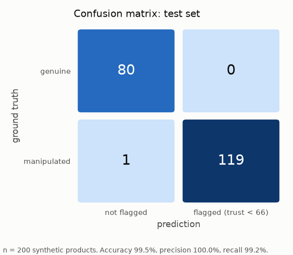
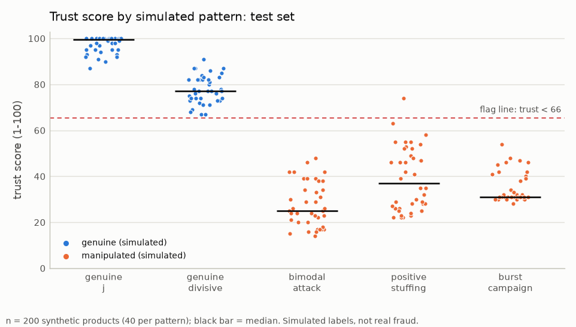
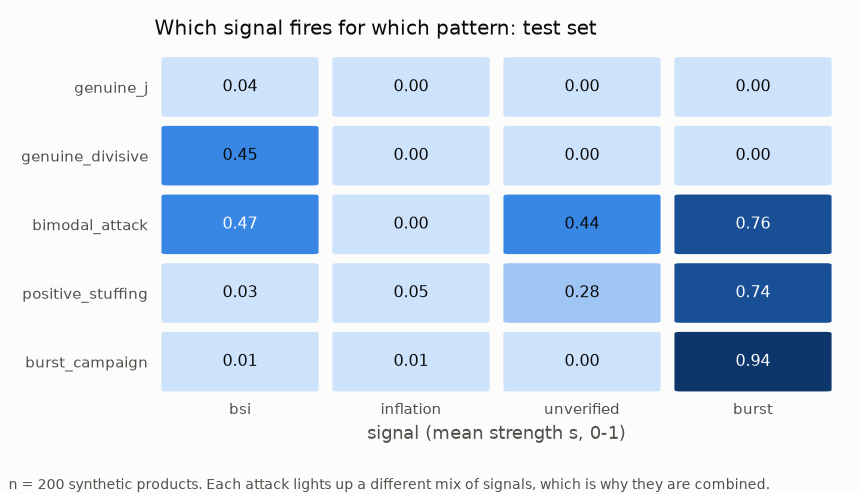

# Evaluation

Code: [`analysis/evaluate.py`](../analysis/evaluate.py) · Outputs: `outputs/evaluation/` ·
Source: PRD section 10 (evaluation method) and section 15 (> 90 % on the synthetic test set).

A product is predicted **manipulated** when it is flagged (trust < 66). Positive
class = manipulated. Each set has 200 products: 80 genuine (2 patterns) and 120
manipulated (3 patterns), so we report precision, recall and F1 next to
accuracy rather than accuracy alone.

## How we avoided tuning on the test

- The signal thresholds were set from the **real** Amazon data (where real products
  sit) and checked on the **tuning** set (seed 42). See [TRUST_SCORE.md](TRUST_SCORE.md) §2.
- The **test** set (seed 7) was generated and scored once, after the settings were fixed.
- The **stress** set uses a profile the rules were never tuned on: smaller
  injected blocks (20–40 %), longer windows, more verified fakes ([SYNTHETIC_DATA.md](SYNTHETIC_DATA.md)).
- The flag line 66 comes from the PRD. On the tuning set it is also the best
  cut-off (accuracy 88.5 % at 46, 95.5 % at 56, 97.5 % at 66, 92.0 % at 76).

## Headline results

| Set | Accuracy | Precision | Recall | F1 | TP | FP | TN | FN |
|---|---|---|---|---|---|---|---|---|
| tuning (seed 42) | 97.5 % | 99.1 % | 96.7 % | 0.979 | 116 | 1 | 79 | 4 |
| **test (seed 7)** | **99.5 %** | **100 %** | **99.2 %** | **0.996** | 119 | 0 | 80 | 1 |
| stress (seed 7, hard) | 53.0 % | 100 % | 21.7 % | 0.356 | 26 | 0 | 80 | 94 |

The PRD target (> 90 % accuracy on the documented synthetic test set) is met.
**This is accuracy on simulated patterns, not on real-world fake reviews.**

## Per pattern

| Pattern | Truth | Test: flagged | Test: median trust | Stress: flagged | Stress: median trust |
|---|---|---|---|---|---|
| genuine_j | genuine | 0 / 40 | 99.5 | 0 / 40 | 99.5 |
| genuine_divisive | genuine | 0 / 40 | 77 | 0 / 40 | 77 |
| bimodal_attack | manipulated | 40 / 40 | 25 | 11 / 40 | 74 |
| positive_stuffing | manipulated | 39 / 40 | 37 | 0 / 40 | 97 |
| burst_campaign | manipulated | 40 / 40 | 31 | 15 / 40 | 70.5 |

## Each signal on its own (test set)

Trust computed from one signal only, same < 66 flag.

| Signal alone | Accuracy | Recall | Mean s: genuine_j | genuine_divisive | bimodal_attack | positive_stuffing | burst_campaign |
|---|---|---|---|---|---|---|---|
| BSI | 40.0 % | 0 % | 0.04 | 0.45 | 0.47 | 0.03 | 0.01 |
| 5★ inflation | 40.0 % | 0 % | 0.00 | 0.00 | 0.00 | 0.05 | 0.01 |
| Unverified | 41.0 % | 1.7 % | 0.00 | 0.00 | 0.44 | 0.28 | 0.00 |
| Date burst | 96.0 % | 93.3 % | 0.00 | 0.00 | 0.76 | 0.74 | 0.94 |
| **All four combined** | **99.5 %** | **99.2 %** | | | | | |

What this shows:

- **The date burst does most of the work** on this synthetic data, because every
  injected block is packed into 4–30 days while genuine reviews are spread over a year.
- **BSI separates the bimodal attack from J-shaped products but not from genuinely
  divisive ones** (0.47 vs 0.45). By design it can't flag a product alone in
  these cases (it would need s > 0.69). That's why the divisive products all stay unflagged.
- **Unverified** fires on attacks and stuffing but never on genuine products;
  combined with the burst it turns borderline cases into flags (93.3 % → 99.2 % recall).
- **5★ inflation almost never fires.** Adding stuffed 5★ reviews to a J-shaped product only
  lifts the 5★ share to ~74 %, which many real loved products also reach (95th percentile 83 %).
  Rating shape alone can't catch moderate stuffing.

## False positives and false negatives

**Test set:** 1 error.

| Product | Truth | Trust | Why missed |
|---|---|---|---|
| SYN0152 | positive_stuffing | 74 | Small block (15 of 45 reviews in 30 days, burst s = 0.22) and only 27 % unverified (s = 0.20): both just above their start points |

**Tuning set:** 5 errors. Four stuffing products scored 66–79: their 30-day block held
33–36 % of reviews, just above where the burst starts. One genuine divisive product
(SYN0078: 39 % 1★, 42 % 5★, BSI 0.70) scored 65, a false positive, exactly the
"naturally divisive" case the PRD warns about.

**Stress set:** 94 false negatives, 0 false positives. Smaller blocks (20–40 %)
spread over 1–2 months stay below the burst start point, and more of the fakes
are verified, so the unverified signal stays quiet. **Positive stuffing at this
level was never caught.** It is the main limitation of a method that only uses
ratings, verification and dates.

All errors with their reasons: `outputs/evaluation/errors_*.csv` and the dashboard's Evaluation tab.

## Real data (no labels)

On 6,335 real Electronics products the tool flags 160 (2.5 %): 136 "mixed
signals", 24 "suspicious". We can't say how many are really manipulated. The
flag only says "these deserve a closer look". The leading reasons were 5★
inflation (53), unverified share (52), a date burst (40) and a two-camp split (15).
