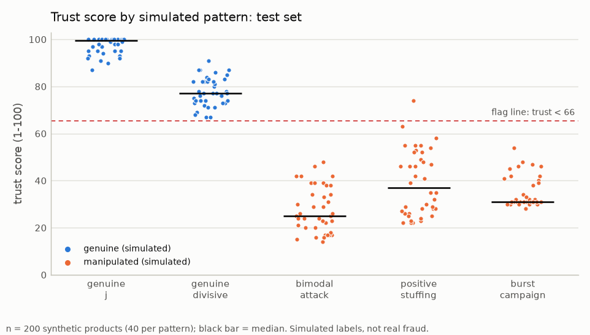
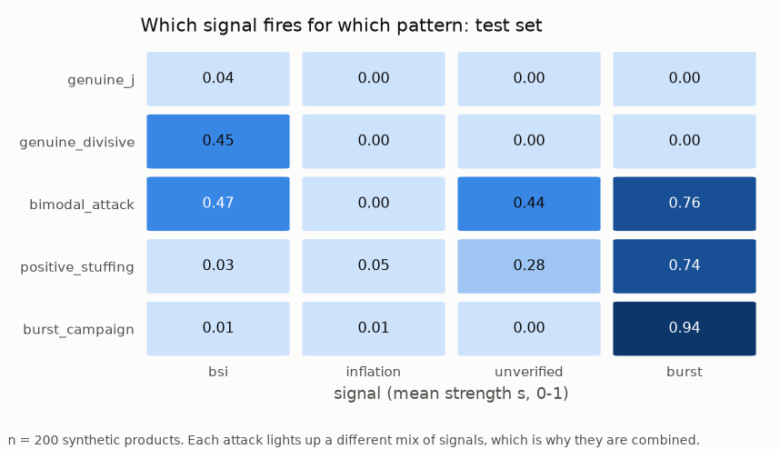
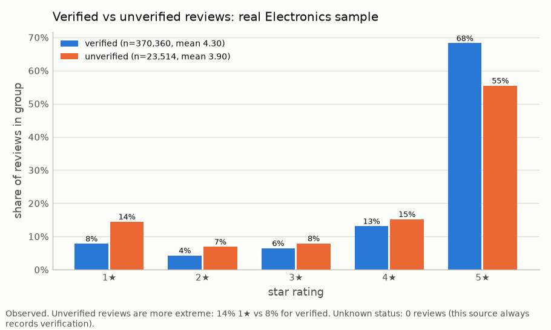
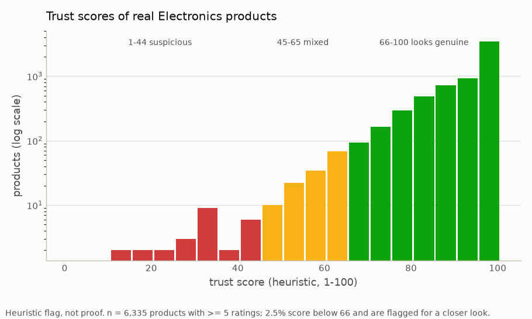

# FakeReview Radar: findings report

Chirag Malik & Amrit Rai · Polaris OJT 2026 · PST_DA_006 · Mentor: Tanishka

## Question

Can statistical analysis of review ratings and review timing identify
suspicious patterns that may indicate artificial review manipulation?

## Data and method

- **Real data:** Amazon Reviews 2023, Electronics: 393,874 cleaned reviews of 6,335
  products (first 1,000,000 lines of the file, products with ≥ 20 reviews). No labels. ([DATASET.md](DATASET.md))
- **Synthetic data:** 5 patterns with known labels (2 genuine, 3 manipulated), 200 products per set;
  separate tuning (seed 42), test (seed 7) and harder stress sets. ([SYNTHETIC_DATA.md](SYNTHETIC_DATA.md))
- **Pipeline:** clean with a logged rule set → per-product star shares, mean, variance,
  skewness, kurtosis → four warning signals (BSI, 5★ inflation, unverified share, date burst)
  → noisy-OR trust score from 1 to 100, flagged below 66. ([TRUST_SCORE.md](TRUST_SCORE.md))

## Results

**1. The signals separate simulated manipulation from normal behaviour.** On the
test set the flag caught 119 of 120 manipulated products with no false alarms:
**accuracy 99.5 %, precision 100 %, recall 99.2 %** (target > 90 %). Every
genuine product, including the naturally divisive ones, stayed above the flag line.

**2. Combining signals matters; no single signal is enough.** The date burst alone
reaches 93.3 % recall; adding the other signals lifts it to 99.2 %. BSI tells a
bimodal attack apart from a normal J-shape but **not** from a genuinely divisive
product (mean 0.47 vs 0.45), which is why BSI alone can only lower trust to 51.
Polarisation is not proof.

**3. Verified and unverified buyers rate differently.** In the real data,
unverified reviews (6 % of all) are more extreme: 14 % 1★ vs 8 %, mean 3.90 vs 4.30★,
variance 2.20 vs 1.54, skewness −1.02 vs −1.70. That supports using the unverified
share, and the rating gap, as a signal. It doesn't make unverified reviews fake.

**4. On real products the tool is cautious.** 160 of 6,335 products (2.5 %) are
flagged: 136 "mixed signals", 24 "suspicious". The most common lead reasons are
5★ inflation, a high unverified share and a review burst. Highly polarised real
products (BSI ≥ 0.3) are **no more likely** to show a review burst than the rest
(4.0 % vs 4.1 %), so in this sample polarisation and review velocity aren't linked.

## Limitations ([LIMITATIONS.md](LIMITATIONS.md))

- **Synthetic accuracy is not real-world accuracy.** On the stress set (smaller
  attacks spread over 1–2 months, more verified fakes) accuracy falls to **53 %**
  (recall 21.7 %), and moderate positive stuffing was never caught. Rating shape
  alone can't tell stuffed 5★ reviews from a loved product.
- **The real sample is not random**: it's grouped by reviewer, which thins out
  bursts, and it covers popular Electronics products up to March 2023 only.
- **No text, reviewer history or seller data** is used.

## Conclusion

Rating shape, verification status and review timing together flag simulated
manipulation reliably when the attack is large or fast. They miss small, slow,
well-hidden attacks. The trust score is useful for deciding **which products
deserve a closer look**, and is presented as a heuristic indicator with its
reasons, never as proof that reviews are fake.
