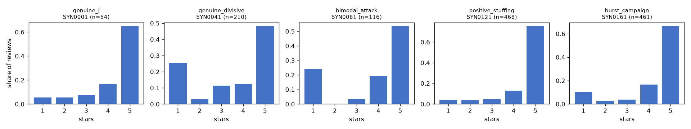

# Synthetic data: how the patterns are generated

Code: [`analysis/generate_synthetic.py`](../analysis/generate_synthetic.py) · Tests:
[`tests/test_scenarios.py`](../tests/test_scenarios.py) · Source: PRD section 6
("document how the suspicious patterns were generated").

Real reviews have no "fake / real" labels, so we can't measure accuracy on them.
Synthetic products have a known answer: we decide which ones are manipulated
and which individual reviews were injected.

## One product, step by step

1. **Size:** 30–300 genuine reviews (uniform).
2. **Genuine reviews** (every product, manipulated or not):
   - star shares drawn from a Dirichlet distribution around the pattern's template
     (concentration 60), so no two products have exactly the same shape;
   - each review is verified with a per-product probability drawn from 85–99 %
     (real Electronics products: median 96 % verified, 90 % of products ≥ 84 %);
   - dates spread evenly over the year before 2025-12-31.
3. **Injected block** (manipulated patterns only): extra reviews equal to 40–80 %
   of the genuine count, with their own star shares and verified probability,
   all dated inside one short window placed at a random point in the year.
   Rows are labelled `is_injected = True`.

Columns follow [DATA_DICTIONARY.md](DATA_DICTIONARY.md): `product_id, review_id, rating,
review_date, verified_purchase (verified / unverified), source = synthetic, pattern,
is_manipulated_product, is_injected`.

## The five patterns (standard profile)

| Pattern | Manipulated | Genuine template 1★…5★ (%) | Injected block: stars 1★…5★ (%) | Injected verified | Window |
|---|---|---|---|---|---|
| `genuine_j` | no | 8 / 4 / 7 / 17 / 64 | none | | |
| `genuine_divisive` | no | 28 / 8 / 8 / 14 / 42 | none | | |
| `bimodal_attack` | yes | 8 / 4 / 7 / 17 / 64 | 45 / 0 / 0 / 0 / 55 | 20 % | 10 days |
| `positive_stuffing` | yes | 8 / 4 / 7 / 17 / 64 | 0 / 0 / 1 / 4 / 95 | 35 % | 30 days |
| `burst_campaign` | yes | 8 / 4 / 7 / 17 / 64 | 1 / 1 / 3 / 15 / 80 | 85 % | 4 days |

Seed 42 (the tuning set, `data/reviews_synthetic.csv`), 40 products per pattern, 44,517 reviews:

| Pattern | Reviews | Avg rating | % verified | % injected |
|---|---|---|---|---|
| genuine_j | 7,294 | 4.19 | 91.8 | 0 |
| genuine_divisive | 6,630 | 3.35 | 92.2 | 0 |
| bimodal_attack | 9,478 | 3.90 | 64.4 | 37.1 |
| positive_stuffing | 10,396 | 4.48 | 70.4 | 38.0 |
| burst_campaign | 10,719 | 4.39 | 89.5 | 36.7 |



## The "hard" profile (stress test)

Same rating shapes, but the attacks are built to be harder to see. The signal
settings were **never** tuned on this profile.

| Pattern | Block size | Injected verified | Window |
|---|---|---|---|
| bimodal_attack | 20–40 % (not 40–80 %) | 40 % (not 20 %) | 21 days (not 10) |
| positive_stuffing | 20–40 % | 55 % (not 35 %) | 60 days (not 30) |
| burst_campaign | 20–40 % | 90 % (not 85 %) | 7 days (not 4) |

## The three sets used in the evaluation

| Set | Seed | Profile | File | Used for |
|---|---|---|---|---|
| tuning | 42 | standard | `data/reviews_synthetic.csv` (in git) | sanity-checking signal settings while building them |
| test | 7 | standard | `data/reviews_synthetic_test_seed7.csv` (regenerated) | headline result; not looked at while tuning |
| stress | 7 | hard | `data/reviews_synthetic_hard_seed7.csv` (regenerated) | where the method breaks |

`tests/test_scenarios.py` uses a fourth seed (123).

```bash
python analysis/generate_synthetic.py --seed 42 --plot           # tuning set + example chart
python analysis/generate_synthetic.py --seed 7 --profile hard --out data/reviews_synthetic_hard_seed7.csv
```

## Known weaknesses of this generator

- The genuine reviews are spread **evenly** over one year. Real products have a
  launch peak and a long tail, which this generator does not imitate, so the
  burst signal has an easier job here than on real data.
- The patterns were designed by us, knowing which signals we would build. That's
  why the test set scores so well and why the stress set and real data are
  reported next to it (see [EVALUATION.md](EVALUATION.md)).
- No review text, reviewer IDs or helpful votes are generated.
