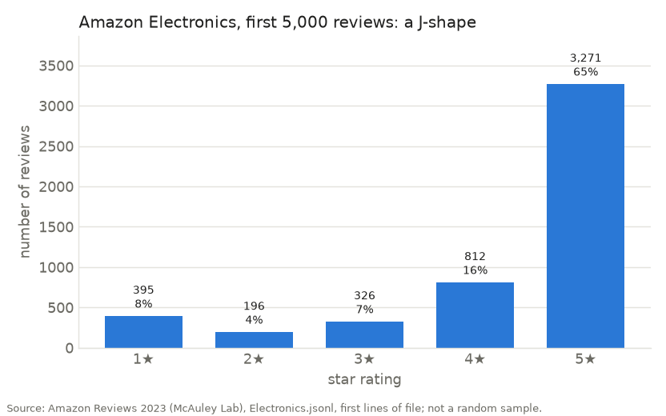
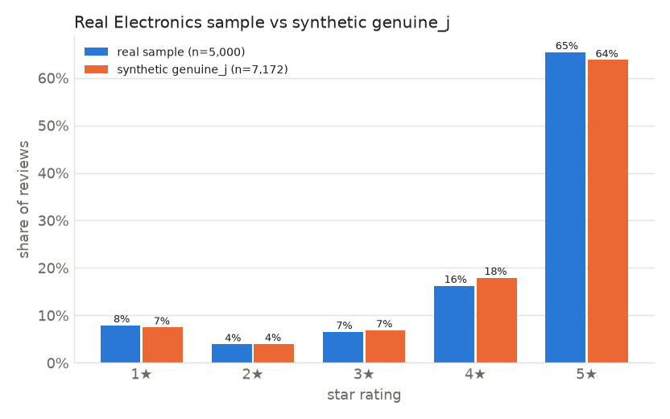

# Week 1 findings: first look at real Amazon Electronics reviews

Script: [`analysis/inspect_sample.py`](../analysis/inspect_sample.py) · Run: `python analysis/inspect_sample.py`

## Data

- **Source:** Amazon Reviews 2023 (McAuley Lab, Hugging Face), `raw/review_categories/Electronics.jsonl`
- **Sample:** first **5,000 lines** of the file, streamed and cut with `head -n 5000`. Saved as `data/raw/electronics_sample.jsonl` (3.5 MB, git-ignored). The download path in the task sheet worked as given:
  `https://huggingface.co/datasets/McAuley-Lab/Amazon-Reviews-2023/resolve/main/raw/review_categories/Electronics.jsonl`

## Shape and types

`df.shape` = **(5000, 10)** raw columns (+ `review_date` we add = 11).

| Column | dtype (read with `dtype=False`) | Notes |
|---|---|---|
| `rating` | float64 | always a whole number (1.0–5.0) |
| `title`, `text` | string | |
| `images` | object (list) | 199 rows have at least one image |
| `asin`, `parent_asin` | string | 2,245 rows have `asin ≠ parent_asin` (variants) |
| `user_id` | string | |
| `timestamp` | int64 | milliseconds since 1970 |
| `helpful_vote` | int64 | 3,711 of 5,000 are 0 |
| `verified_purchase` | bool | |

**Gotcha found:** with default settings `pd.read_json` silently converts any
column called `timestamp` into a datetime, so the raw value is never seen. It
happened to guess milliseconds correctly, but we shouldn't rely on that. The
script reads with `dtype=False` and converts explicitly with
`pd.to_datetime(ts, unit="ms")`.

## Missing values

`df.isna().sum()` is **0 for every column**. Missing data shows up as empty
strings instead of NaN:

| Check | Count |
|---|---|
| empty `text` | **2** (both 5★, titles "It works" / "TiMOVO Check it Out") |
| empty `title`, `user_id`, `parent_asin` | 0 |
| missing `verified_purchase` | 0 |
| unparseable `timestamp` | 0 |

So the cleaning code has to treat `""` as missing (R6), not only NaN.

## Ratings

| Stars | Count | % |
|---|---|---|
| 1★ | 395 | 7.9 |
| 2★ | 196 | 3.9 |
| 3★ | 326 | 6.5 |
| 4★ | 812 | 16.2 |
| 5★ | 3,271 | 65.4 |

Mean **4.27**, variance **1.51**, skewness **−1.68**, excess kurtosis **+1.58**.
A clear J-shape, almost identical to the PRD's prior π = 8 / 4 / 7 / 17 / 64.
Ratings outside 1–5 or missing: **0**.

## Verified purchase

| | Reviews | % | Mean rating |
|---|---|---|---|
| verified | 3,350 | **67.0** | 4.23 |
| unverified | 1,650 | 33.0 | 4.36 |
| unknown | 0 | 0 | |

Unverified reviewers rate slightly **higher** (+0.13 stars). That's worth
following up in Week 3, but this sample can't tell us whether it's real or
just a few heavy reviewers (see limitations).

## Date range

**2003-03-06** to **2023-03-16**. Volume grows over time and peaks in 2020
(809 reviews). 2023 is short (126) because collection ended partway through the
year. 87 % of the sample is from 2015 or later.

## Products

- **4,509** distinct `parent_asin` (4,673 distinct `asin`) in 5,000 reviews, so almost every product appears once.
- Top 10 products by review count: 17, 16, 13, 12, 10, 9, 9, 6, 6, 6 (`B075X8471B` has the most).
- Products with < 5 reviews: **4,494**. With ≥ 20: **0**.

**No product in this sample has enough reviews to compute a meaningful BSI
or trust score.** This sample is only good for checking fields and the overall
rating shape. Per-product analysis needs the Week 2 sample (see below).

## Matches with cleaning rules (task 5)

| Rule | Found in sample |
|---|---|
| R1 rating outside 1–5 | 0 |
| R2 missing rating | 0 |
| R3 duplicates (user + product + timestamp, or user + product + text + date) | 0 |
| R4 invalid date | 0 |
| R5 missing verification | 0 |
| R6 missing text | **2** (as empty strings) |
| R7 date format | **5,000** need converting from Unix ms |
| R8 small sample | **4,509 of 4,509** products < 20 reviews |

The real data is much cleaner than the PRD expects. The rules still matter for
other categories, the synthetic and hand-built data, and the extension's
scraped data.

## Real vs synthetic `genuine_j` (feedback for Amrit)

| Stars | Real % | Synthetic genuine_j % | Difference |
|---|---|---|---|
| 1★ | 7.9 | 7.5 | +0.4 |
| 2★ | 3.9 | 4.0 | −0.1 |
| 3★ | 6.5 | 6.9 | −0.3 |
| 4★ | 16.2 | 17.9 | −1.7 |
| 5★ | 65.4 | 63.8 | +1.7 |

| | Mean | Variance | Skewness | Kurtosis | % verified |
|---|---|---|---|---|---|
| Real sample | 4.274 | 1.512 | −1.677 | 1.580 | **67.0** |
| Synthetic genuine_j | 4.265 | 1.467 | −1.662 | 1.600 | **89.9** |

**Rating shape: no change needed.** Every star is within 2 percentage points
and all four metrics are very close.

**Verified share: worth adjusting.** Genuine products in the synthetic data
are ~90 % verified, while the real sample is 67 %. If the unverified signal is
tuned on synthetic data where genuine products are 90 % verified, a real
genuine product at 67 % could look suspicious. Suggestion: lower
`GENUINE["genuine_j"]["verified"]` toward ~0.70 (and divisive similarly), or
draw it per product from a range such as 0.6–0.95. Re-check with the proper
Week 2 sample first, since this number is affected by the sampling bias below.

## Limitations

- **Not a random sample: the file is grouped by reviewer.** The first 5,000 lines contain only **763 reviewers**, each in one contiguous block. The three biggest contribute 223, 216 and 200 reviews. So the sample describes a few hundred people's habits, not Electronics as a whole. The verified share, the unverified-rate-higher result and the date spread may all reflect a handful of heavy reviewers.
- **Almost no repeated products.** Because rows are grouped by reviewer, products are scattered and nearly every product appears once. Product-level metrics can't be tested on this sample.
- **Possible order bias.** We don't know how the file's users are ordered (by ID, by first-review date, …). If it's by account age or activity, the first lines over-represent one kind of reviewer.
- **The whole dataset** has its own known biases (PRD §6): collection stops in 2023, there are no fake/real labels, and it leans toward products with many reviews.
- **Next (Week 2):** take a proper sample, e.g. reservoir sampling or every k-th line across the whole file. Or better for product-level work, pick a random set of `parent_asin`s and keep **all** their reviews, so each product has its full rating distribution.
